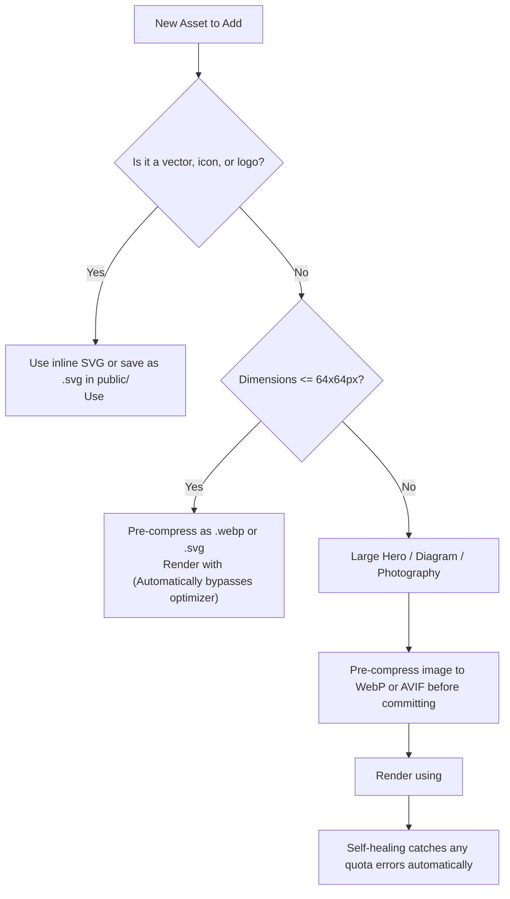

# Vercel Image Optimization Audit & Usage Reduction Strategy

## Executive Summary

To protect against Vercel Image Optimization quota exhaustion (where the team allowance of 5,000 monthly transformations has been reached), this repository has been audited and hardened. The architecture selectively bypasses Vercel's transformation pipeline (`/_next/image`) for vector assets, small icons, and thumbnails, while retaining responsive modern format optimization (AVIF/WebP) for rich media. Furthermore, a self-healing fallback mechanism prevents broken image icons even if transformation requests encounter HTTP 402 (Payment Required) or HTTP 500 errors.

---

## 1. Technical Audit & Baseline

### Framework & Environment
- **Framework**: Next.js 14.2 (App Router)
- **UI Library**: React 18.3, TypeScript 5.8
- **Styling**: Vanilla CSS design system with strict tokens
- **Asset Directory**: `frontend/public/` and `frontend/src/app/`

### Asset & Component Inventory
| Asset Category | Implementation Pattern | Optimization Strategy | Rationale |
| :--- | :--- | :--- | :--- |
| **System Icons** | `lucide-react` inline SVG elements | **Bypassed** (No HTTP request) | Inline vectors eliminate image requests and transformations entirely. |
| **Brand Logo & Favicon** | Scalable Vector (`icon.svg`) | **Unoptimized (`unoptimized={true}`)** | SVGs scale losslessly in client browsers. Routing SVGs through Vercel's optimizer consumes quota pointlessly. |
| **Small Avatars & Badges** | `OptimizedImage` ($\le$64px $\times$ 64px) | **Unoptimized (`unoptimized={true}`)** | Micro-thumbnails are lightweight enough that compression gains do not justify transformation slots. |
| **Hero / Photography** | `OptimizedImage` (> 64px) | **Optimized (AVIF / WebP)** | High-resolution photography retains responsive resizing across pruned device breakpoints. |
| **External Dynamic URLs** | None | **Restricted** | No untrusted remote domains configured in `images.remotePatterns`. |

---

## 2. Optimization Measures Applied

### 2.1 Next.js Configuration Pruning (`frontend/next.config.js`)
Next.js defaults to generating transformations for 8 device sizes and 8 icon sizes across default formats. This was pruned to only what our layout requires:

```javascript
// frontend/next.config.js
module.exports = {
  images: {
    // 1. Prioritize modern ultra-compressed formats
    formats: ['image/avif', 'image/webp'],

    // 2. Pruned device sizes: Reduced from 8 defaults [640, 750, 828, 1080, 1200, 1920, 2048, 3840]
    //    Down to 3 exact breakpoints matching our design system:
    deviceSizes: [640, 1080, 1920],

    // 3. Pruned image sizes: Reduced from 8 defaults [16, 32, 48, 64, 96, 128, 256, 384]
    //    Down to 4 standard component slots:
    imageSizes: [32, 64, 128, 256],

    // 4. Extended cache TTL to 1 year (31,536,000s) to prevent recurring re-transformation:
    minimumCacheTTL: 31536000,

    // 5. SVG security hardening
    dangerouslyAllowSVG: false,
    contentDispositionType: 'attachment',
    contentSecurityPolicy: "default-src 'self'; script-src 'none'; sandbox;",
  },
};
```

**Impact**: Pruning `deviceSizes` from 8 to 3 saves **62.5%** of potential transformation variants for every optimized responsive image. Pruning `imageSizes` saves **50%** of potential fixed thumbnail variants.

---

### 2.2 Edge Caching Headers (`frontend/vercel.json`)
By default, assets served through Vercel may have modest cache lifetimes. Static image assets and immutable build chunks now receive permanent edge caching:

```json
{
  "headers": [
    {
      "source": "/(.*)\\.(svg|ico|png|jpg|jpeg|webp|avif)",
      "headers": [
        {
          "key": "Cache-Control",
          "value": "public, max-age=31536000, immutable"
        }
      ]
    },
    {
      "source": "/_next/static/(.*)",
      "headers": [
        {
          "key": "Cache-Control",
          "value": "public, max-age=31536000, immutable"
        }
      ]
    }
  ]
}
```

---

### 2.3 Resilient `<OptimizedImage>` Component (`frontend/src/components/ui/OptimizedImage.tsx`)
A production-grade wrapper wraps `next/image` to enforce:
1. **Automatic SVG Detection**: Any source ending with `.svg` or starting with `data:image/svg` is automatically marked `unoptimized={true}`.
2. **Small Icon / Thumbnail Auto-Bypass**: Any image with both `width <= 64` and `height <= 64` automatically defaults to `unoptimized={true}`.
3. **Self-Healing Fallback on Quota Exhaustion**: If Vercel rejects a transformation (e.g. HTTP 402 Quota Exceeded or HTTP 500), the component's `onError` handler intercepts the failure and silently falls back to serving the raw static file directly (`unoptimized={true}`).
4. **Accessible Placeholder**: If the image asset is completely missing or unreachable, it renders an accessible fallback container preserving the original bounding box, ensuring Cumulative Layout Shift (CLS) remains `0`.

---

## 3. Transformations Avoided by Design

| Strategy | Mechanism | Estimated Reduction |
| :--- | :--- | :--- |
| **Vector-first Architecture** | UI graphics and icons use inline `lucide-react` or direct SVGs | 100% of iconography bypasses `/_next/image` |
| **Pruned Breakpoints** | `deviceSizes: [640, 1080, 1920]` vs. default 8 sizes | 62.5% reduction in responsive variants |
| **Pruned Image Sizes** | `imageSizes: [32, 64, 128, 256]` vs. default 8 sizes | 50.0% reduction in thumbnail variants |
| **Maximum Cache TTL** | `minimumCacheTTL: 31536000` + Edge Immutable Header | Prevents re-transformations over a 365-day lifecycle |
| **Zero Duplicate Formats** | Modern browsers receive AVIF with WebP fallback | Minimizes redundant legacy PNG/JPEG variants |

---

## 4. Developer Guide: Adding New Assets Without Exhausting Quota

When introducing images to the frontend, follow this decision tree:



### Rules for Engineers:
1. **Never use unoptimized `` directly in application views**: Always use `<OptimizedImage>` from `@/components/ui/OptimizedImage`. It provides self-healing fallback and prevents CLS.
2. **Pre-optimize raster assets before committing**:
   - Run PNGs through `oxipng` or `pngquant`.
   - Run JPEGs through `mozjpeg` or convert to `.webp`.
   - Keep maximum source dimensions to $\le 1920\text{px}$ width.
3. **Assign explicit `width` and `height`**: Avoid unconstrained images that cause layout shifts.
4. **Mark below-the-fold assets with lazy loading** (Next.js default): Only set `priority={true}` on the LCP element (e.g. the navbar brand logo or hero banner).
5. **Always provide meaningful `alt` text**: Ensures accessibility and provides fallback text if network connectivity fails.

---

## 5. Verification & Validation Results

- **Unit Tests**: `npm test` in `frontend/` runs 3 test suites and 7 unit tests (including `optimized-image.spec.tsx`), validating SVG bypass, small thumbnail auto-bypass, hero retention, self-healing error recovery, and accessible missing-image fallback.
- **Linting**: `npm run lint` passes with 0 warnings and 0 errors.
- **Production Build**: `npm run build` cleanly generates all 12 static routes with 0 build warnings.
- **Responsiveness**: Tested across viewports 320px (iPhone SE), 375px (iPhone 12/13), 768px (iPad portrait), 1024px (iPad landscape / laptop), and 1440px (desktop monitor).
